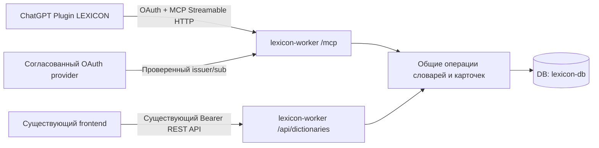

# LEXICON MCP Plugin — технический план v1

Исторический план до реализации, 2026-10-29. Его предположения не являются
описанием текущего runtime. CP-002 реализует собственный OAuth с opaque tokens
и общим сервисным слоем. Актуальные инструкции: [MCP_CONNECT.md](MCP_CONNECT.md),
фактический статус публикации: [CHECKPOINTS.md](CHECKPOINTS.md).

## 1. Подтверждённая основа

- Frontend — статический HTML/JS/CSS в корне; словари обслуживаются функциями
  dictionaryApi и normalizeDictionaryFromApi/normalizeWordFromApi в `app.js`.
- Backend — локальный импорт `backend/worker.js`. Его соответствие сегодняшнему
  production-коду повторно не проверялось: анализ относится к сохранённой версии.
- Worker: `lexicon-worker`, Account ID `e7dd176c5580b561da2048b23ed5f6c0`.
  Базовый URL `https://lexicon-worker.timashevanatoly10.workers.dev`.
- D1 `lexicon-db`, binding `DB`, ID `6e63edd9-166b-400a-a644-caf474dc0ce6`.
  Реальная структура проверена отдельно, только чтением системных метаданных:
  [MCP_SCHEMA_SNAPSHOT.md](MCP_SCHEMA_SNAPSHOT.md).
- MCP SDK, маршрута /mcp, OAuth discovery и отдельной модели разрешений в
  исследованном коде нет. Учётная запись ChatGPT, её тариф, роль и доступность
  custom MCP write-tools не проверены.

### Существующие API и безопасное переиспользование

| API | Реальное поведение | Переиспользование / ограничения |
|---|---|---|
| GET /api/dictionaries | Все словари владельца со всеми словами и meta; сортировка словарей updated_at DESC, слов created_at DESC | Годится для ограниченного прототипа чтения и адаптации результата; нет pagination, summary-only и ограничения ответа |
| POST /api/dictionaries | title/note/id; генерирует id при отсутствии; ON CONFLICT(id) обновляет словарь того же владельца | Переиспользовать бизнес-операцию, но MCP нужен create-only режим, серверный ID и идемпотентность; нельзя открывать произвольный id из модели |
| POST /api/dictionaries/{id}/words | Проверяет владельца словаря, trim(word), lower(word)-дубль; возвращает duplicate:true и существующее слово | Годится для одиночной последовательной записи; не обеспечивает атомарный batch и полную нормализованную дедупликацию |
| PUT /api/dictionaries/{id}/words/{wordId}/meta | Заменяет meta слова после проверки владельца | Сохраняет текущие полные карточки; v1 не должен давать модели произвольную замену meta существующих слов |
| PUT/DELETE словарей и DELETE слов | Изменение/удаление | Не публиковать как MCP tools v1 |
| GET /public/dictionary/{shareId} | Публичное чтение активной ссылки | Не использовать для личной авторизации и не создавать ссылки автоматически |

Отдельных приватных GET /api/dictionaries/{id}, GET /words/search и batch POST
в сохранённом Worker нет. Поиск frontend сейчас фильтрует загруженные данные
в памяти (word, translation, transcription, partOfSpeech; также title/note словарей).

Точки локального кода: `backend/worker.js` requireAuthContext:276,
handleGetDictionaries:338, handleCreateDictionary:394,
handleCreateDictionaryWord:529, rowToWord:740; `app.js` dictionaryApi:4998,
normalizeWordFromApi:5033, enrichDictionaryWordFullCard:5281,
renderDictionaryList:11047, openWordFromDictionary:11990.

### Авторизация и ограничения текущей модели

Сейчас Authorization: Bearer проверяется по записям ACCESS_TOKENS, разделённым
запятыми. `owner_token_hash = SHA-256(исходного токена)` определяет владельца данных.
Отдельных scopes и OAuth жизненного цикла в коде нет; тот же токен открывает
другие защищённые функции Worker. CORS выдаёт браузерные заголовки, но не заменяет
серверную авторизацию и не защищает от server-to-server запросов.

Новый случайный токен в ACCESS_TOKENS получит другой owner_token_hash и не увидит
старые словари. Нельзя хешировать OAuth access token и использовать этот меняющийся
хеш как владельца. Ротация старого токена также требует отдельного решения о
привязке владельца; автоматически менять существующие токены нельзя.

Схема подтверждает UNIQUE(dictionary_id, word), но без нормализации регистра.
SELECT lower(word), затем отдельный INSERT оставляют гонку для Pump/pump.
Одинаковый регистрозависимый текст защищён индексом. Статистика уже существующих
регистровых/Unicode-дублей не проверялась.

## 2. Рекомендуемая архитектура



Предлагаемый endpoint: `https://lexicon-worker.timashevanatoly10.workers.dev/mcp`.
Сейчас он не создан. Добавить его позднее в существующий Worker, сохранив одну
привязку DB. Не создавать новую базу, копии словарей, публичный зеркало-кэш или
отдельный Worker для v1. GitHub Pages остаётся только frontend-хостингом.

Выделить общий слой операций из текущих обработчиков. REST сохраняет формат
ответов и свой способ аутентификации. MCP после проверки OAuth передаёт доверенный
Principal `{ownerTokenHash, scopes, grantId}` в тот же слой. Значения владельца
не принимаются из tool arguments, заголовков пользователя или непроверенных claims.
Не пересылать OAuth access token как старый токен REST и не обходить requireAuthContext
через публичный заголовок x-owner-token-hash.

Прототип без изменения backend возможен как адаптер REST с серверным хранилищем
старого токена; он загрузит весь корпус для get/search и будет добавлять слова
по одному. Это не рекомендуемый production-вариант: широкий legacy-токен,
неатомарные записи, нет корректного повторения операции при потере ответа.

## 3. Контракт пяти инструментов

Все инструменты требуют OAuth. JSON Schema закрывает неизвестные поля;
результаты содержат structuredContent, краткий текст и безопасные коды ошибок.

| Tool | Основные входы | Ответ и поведение | Scope |
|---|---|---|---|
| list_dictionaries | title_query?, limit=50 (max100), cursor? | id/title/note/word_count/updatedAt и next_cursor; без полного корпуса по умолчанию | lexicon.dictionaries.read |
| get_dictionary | dictionary_id, limit=50 (max100), cursor?, include_card=false | Метаданные и страница слов; карточки только по запросу | lexicon.dictionaries.read |
| create_dictionary | title, note?, request_id, allow_same_title=false | Новый dictionary_id; не upsert. При совпадении title вернуть кандидатов для уточнения, если явно не разрешены одинаковые названия | lexicon.dictionaries.create |
| add_words | dictionary_id, request_id, words[1..50] | Атомарное добавление новых карточек; дубли пропускаются без перезаписи; per-item статусы и счётчики | lexicon.words.write |
| search_words | query, dictionary_id?, match=exact/prefix/contains, limit=50 (max100), cursor? | Совпадения word/translation/transcription/partOfSpeech с dictionary_id и word_id; только текущий владелец | lexicon.dictionaries.read |

`get_dictionary` и `add_words` принимают только точный ID, а не название или
номер строки. При нескольких одноимённых словарях ChatGPT сначала показывает
кандидатов из list_dictionaries и спрашивает пользователя. Не выбирать первый
словарь, не искать чужой ID и не создавать новый словарь при ошибке 404.
create_dictionary не гарантирует глобальную уникальность названий: существующая
модель допускает их повторение. Однозначность обеспечивается ID.

Предлагаемые лимиты: title 1..200 символов, note до 2000, word 1..256,
translation до 4000; тело до 256 KiB, карточка до 8 KiB, batch до 50 элементов.
Пустые/слишком большие входы отклоняются до записи. Точные значения согласовать
при реализации. Поиск — сначала без FTS/эмбеддингов, параметризованный SQL;
LIKE-метасимволы экранируются. Пользователь не задаёт SQL, таблицы, URL или owner.
Cursor непрозрачный, проверяемый и привязанный к владельцу, фильтрам и стабильному
порядку created_at/id; ограничения согласованности при параллельных изменениях
должны быть описаны и протестированы.

Read tools: readOnlyHint=true. Create/add: readOnlyHint=false,
destructiveHint=false (только create-only/append/skip), openWorldHint=false
(ограниченная частная область LEXICON). idempotentHint=true для writes только
после реализации надёжной идемпотентности. Аннотации не заменяют проверку scopes.

## 4. Batch, дубли и повтор операции

1. Проверить OAuth, scope и владельца словаря. Проверять owner обеих таблиц;
   FK связывает dictionary_id, но сам по себе не доказывает owner совпадение.
2. Проверить весь batch. В v1 не поддерживать частичное выполнение при ошибке
   входа: один invalid item означает ноль новых записей.
3. Предлагаемый ключ: Unicode NFC + trim + схлопывание пробелов + детерминированный
   lowercase. Отображаемое написание сохранить. Не убирать акценты/пунктуацию,
   не лемматизировать и не объединять run/running или разные фразы.
4. Дубликаты внутри batch и уже существующие слова возвращать как
   duplicate_in_batch / duplicate_existing со ссылкой на канонический word_id.
   Не обновлять существующий перевод или meta через add_words.
5. Уникальность ключа должна обеспечиваться базой для всех писателей, включая REST.
   Предполагается согласуемая миграция normalized_word + уникальный индекс
   (dictionary_id, normalized_word), с одинаковой нормализацией REST/MCP.
   До этого — отдельный разрешённый аудит конфликтов; ничего не удалять/сливать
   автоматически. Новый индекс не применять вслепую.
6. request_id ограничить владельцем и операцией; сохранить digest канонического
   входа и результат. Повтор того же payload возвращает прежние ID и replayed=true;
   тот же request_id с другим payload — IDEMPOTENCY_CONFLICT.
7. Предлагаемая служебная таблица mcp_operations в той же D1 хранит идемпотентность,
   а не копию словарей. Нужны сроки хранения ключей и честная граница повторов.
   Изменения слов и завершённый результат операции должны фиксироваться атомарно;
   точный D1 batch/transaction-механизм проверить при реализации. Сетевой таймаут
   не считать доказательством отсутствия записи.

Миграции выше только предложены. Их создание/применение, D1-тесты и проверка данных
требуют отдельного разрешения. Нельзя обещать production-гарантию batch/idempotency
поверх существующих последовательных POST без этих дополнительных механизмов.

## 5. Карточки, совместимые с приложением

Хранимая модель уже есть: id, word, transcription, translation, partOfSpeech,
meta, createdAt, updatedAt. API partOfSpeech сопоставляется с D1 part_of_speech;
meta — JSON в TEXT. Сервер генерирует id и timestamps, принимает только типизированные
поля карточки. Не открывать произвольные meta/raw HTML или owner-поля для модели.

Минимальный вход add_words:

```json
{
  "dictionary_id": "ID_FROM_LIST_DICTIONARIES",
  "request_id": "UUID_FOR_THIS_USER_OPERATION",
  "words": [
    {"client_item_id":"1","word":"pump","translation":"насос","transcription":"/pʌmp/","partOfSpeech":"noun"},
    {"client_item_id":"2","word":"valve","translation":"клапан","partOfSpeech":"noun"}
  ]
}
```

Вариант нормализации сервером для готовой центральной карточки:

```json
{
  "word": "pump",
  "transcription": "/pʌmp/",
  "translation": "насос",
  "partOfSpeech": "noun",
  "meta": {
    "fullCard": {
      "status": "ready",
      "source": "pump",
      "center": {
        "headword": "pump",
        "transcription": "/pʌmp/",
        "parts": [{"pos":"noun","meanings":[{"translation":"насос"}],"extra_examples":[]}]
      },
      "left": null,
      "right": null,
      "errors": []
    }
  }
}
```

Сервер добавит startedAt/updatedAt fullCard и даты слова. Левая/правая панели
с null покажут штатные placeholders. Для расширенных карточек допускаются
типизированные meanings и examples с source/translation_ru, после валидации.
Текущий frontend считает ready даже карточку только с center — это проверено по
isWordFullCardReady и рендереру. Готовый center предотвращает автоматическое
AI-обогащение при раскрытии. Если сохранить только базовые поля с meta:{},
существующий frontend при раскрытии запускает AI-запросы: это отдельный риск
расходов, поэтому такой режим не брать по умолчанию.

Предлагается требовать непустой перевод; ChatGPT подготавливает его до add_words,
а MCP ничего сам не генерирует и не обращается к OpenAI/DeepL. Неизвестную IPA
не выдумывать, разрешить штатный placeholder. Слова и тексты — данные, не инструкции.
Внешние изменения сейчас загрузятся при новом bootstrap frontend; мгновенная
синхронизация открытого UI не подтверждена. PWA Update относится к коду, не к
новым словам. Явный refresh словарей — возможное отдельное UX-улучшение после согласования.

## 6. Авторизация ChatGPT

По официальной документации OpenAI для приватного MCP применять OAuth 2.1,
authorization code + PKCE S256, discovery protected resource / authorization
server, resource/audience и проверку подписи, issuer, expiry и scopes каждого
запроса. Использовать поддерживаемый способ регистрации клиента (CIMD либо
согласованный DCR/predefined client), точный redirect URI из страницы подключения.
Источник: [Authentication](https://developers.openai.com/plugins/build/auth).

Проектное решение: выбрать совместимый OAuth provider отдельно; ни один внешний
провайдер/аккаунт сейчас не настроен и не используется. Доступ к конкретным
словарям выдаётся серверным сопоставлением `(issuer, sub) -> existing owner_token_hash`.
Для v1 — одна явно разрешённая связанная учётная запись; default deny для всех
прочих sub, даже если они успешно прошли OAuth у того же issuer. Связку доказать
контролем существующего аккаунта LEXICON на собственной HTTPS-странице или
в согласованной административной процедуре, не передавать токен в чат.

Для single-owner pilot небольшую карту grant/owner можно хранить в новом Worker
secret; для нескольких пользователей понадобится согласованное постоянное
хранилище связок. Хеш владельца не является самостоятельным ключом входа и не
возвращается в инструментах. OAuth-токены не добавляются в ACCESS_TOKENS.

Read scope выдавать отдельно; создание и добавление — только после явного consent.
Предлагаемый TTL access token 10 минут, отзыв grant и ротация refresh у provider;
реальную поддержку/задержку отзыва проверить до выпуска. Проверять allowlist issuer,
audience именно MCP, token signature и scopes; не доверять JKU/URL из токена.
401 с challenge при отсутствии/невалидности токена; 403 при недостаточных scopes;
чужой dictionary_id — безопасный NOT_FOUND без раскрытия владельца.

OPENAI_API_KEY/DEEPL_API_KEY — только исходящие ключи существующих функций,
не доступ к словарям. MCP v1 не получает их и не умеет вызывать AI, удаление,
публикацию ссылок, чтение секретов, произвольный HTTP или SQL.
Secrets — только Worker secret/хранилище провайдера после отдельного разрешения;
в Git — схемы, публичный issuer/audience и placeholders. В логах только request ID,
операция, безопасный код и счётчики, без токенов, owner hash, карточек и полного текста.
Добавить rate limits, квоты batch и redaction; средства реализации согласовать,
не создавать ресурсы автоматически. Проверять Origin для браузерных MCP-запросов,
но не делать широкое изменение CORS существующих REST API.

## 7. Подключение через ChatGPT Plugins

Актуальная официальная последовательность: ChatGPT web → Plugins → плюс →
Add custom MCP server → имя LEXICON, Server URL → OAuth → подтвердить риск →
Create as a plugin → установить → вызвать через @LEXICON. Поддерживаются Streamable
HTTP и SSE; выбираем Streamable HTTP. Специальные инструменты search/fetch не
обязательны. Writes по умолчанию требуют подтверждения; набор инструментов можно
просмотреть, ограничить и обновить в настройках.
Источник: [Add custom MCP server](https://developers.openai.com/api/docs/guides/custom-mcp-server).

До подключения проверить в своём аккаунте: доступность custom MCP и write tools
по тарифу/региону, роль и право создавать/устанавливать plugin, workspace allowlist,
Lockdown, OAuth linking, допустимые redirect URI и возможность подтверждать writes.
Наличие Plugins само по себе не доказывает доступность всех этих функций.
Не обещать работу на iPhone/в каждом режиме ChatGPT без фактического теста.
Публичный каталог и публикация для других пользователей — отдельная задача;
для личного подключения не создавать legacy ai-plugin.json/OpenAPI-plugin.
Для private development допустим поддерживаемый Tunnel только после отдельного
согласования; GitHub Pages не может выполнять MCP. Инструменты не должны принимать
секреты через ChatGPT, elicitation или tool arguments.

## 8. Предполагаемые файлы и этапы

После согласования: backend/mcp/{transport,auth,tools,contracts}.js,
backend/services/dictionaries.js, общий слой доступа к данным и форматирования
карточек; точечная диспетчеризация в backend/worker.js. Уточнить Worker-совместимый
transport MCP SDK: нельзя без проверки переносить Node HTTP middleware в Worker.
Зависимости и Wrangler bundling — отдельное проверяемое изменение; frontend не
переписывать. Форматы существующих REST-ответов сохранить регрессионными тестами.

Предполагаются локальные тесты auth/contract/ownership/batch и frontend-render;
миграции normalized key и idempotency только после отдельного решения по D1.
Сначала схемы и моки без облака, затем разрешённая локальная D1, затем отдельно
разрешённые ограниченные реальные проверки и только потом production deploy.
Перед ним сверить актуальный Worker, bindings, vars и имена секретов, сохранить
точные исходники в GitHub и получить отдельное разрешение на публикацию.

На согласование нужны: архитектура /mcp в том же Worker, OAuth provider/связывание
одного владельца, лимиты/атомарный batch и разрешение на будущие D1-изменения.
План тестов: [MCP_TEST_PLAN.md](MCP_TEST_PLAN.md). Следующий checkpoint не создаётся.
